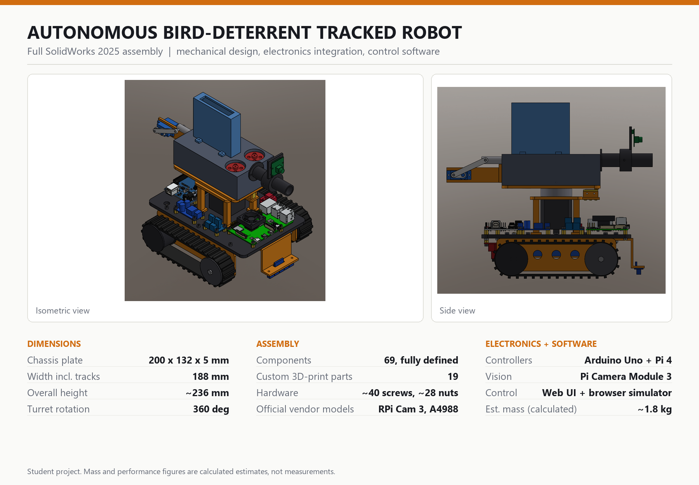
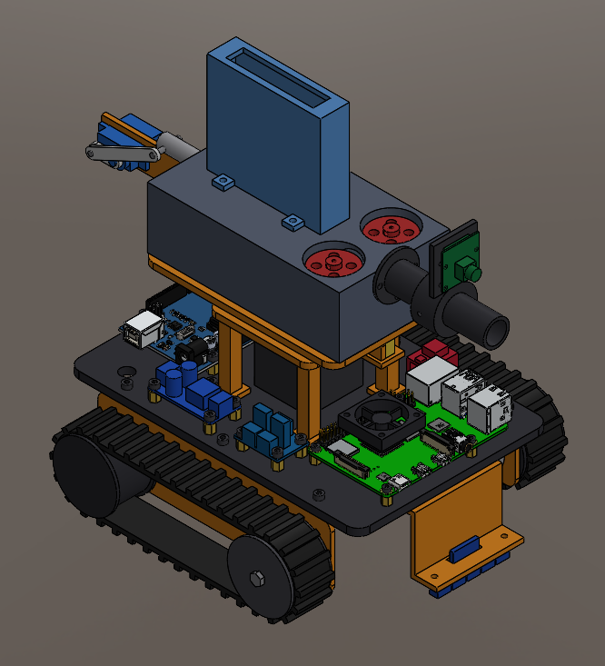

# CAD & Mechanical Design Portfolio

SolidWorks modelling, assemblies and 3D-print-ready parts. Student work, shown for portfolio purposes.

## Autonomous Bird-Deterrent Tracked Robot
Full SolidWorks 2025 assembly: 69 fully defined components, 19 custom 3D-printed parts, official vendor models
(Raspberry Pi Camera Module 3, Pololu A4988), Arduino + Raspberry Pi control software and a browser simulator.
Mass and performance figures are calculated estimates, not measurements.

## Xbox Series X Filtered Dust Dock (concept)
Parametric 3D-printable dock with side filter windows, press-fit filter frames and a screw-on lid
(170 x 170 mm footprint, fits 220 mm print beds). Dimensions are from public specs and not yet verified on a real console.

## Services
Custom part design, reverse-engineering from photos and measurements, 3D-print-ready files (STL/STEP), assembly models.
Contact: open an issue on this repository.
